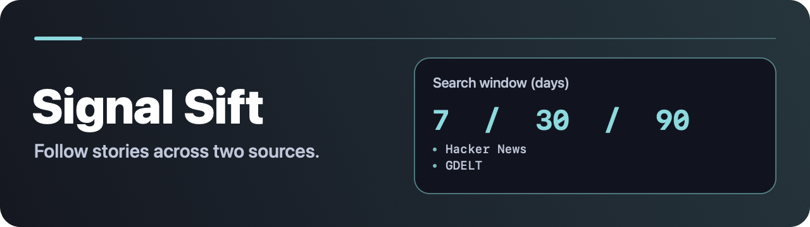

<p align="center">
  
</p>

# Signal Sift

A native Mac search window for following tech stories and niche topics across Hacker News and the wider press.

## At a glance

| Task | How |
| --- | --- |
| **Find stories** | Search Hacker News and GDELT over 7, 30, or 90 days. |
| **Refine the results** | Filter by source or sort by date or source order. |
| **Read or discuss** | Open the original article or its Hacker News discussion when available. |
| **Download for macOS** | [SignalSift-macOS.zip](https://github.com/muddgrrrl/Signal-Sift/releases/latest/download/SignalSift-macOS.zip) |

Duplicate article URLs are grouped after common tracking parameters are removed. Results appear as they arrive. A slow or unavailable source leaves the other source’s results usable.

The app searches [Hacker News via Algolia](https://hn.algolia.com/api) and the [GDELT DOC API](https://blog.gdeltproject.org/gdelt-doc-2-0-api-debuts/). Each service controls its coverage and rate limits. GDELT dates indicate when GDELT first observed the link. Search text is sent to these services when you submit a query. Signal Sift does not require an account or save a search history.

## Install

Download **SignalSift-macOS.zip** from [Releases](https://github.com/muddgrrrl/Signal-Sift/releases/latest), extract it, and move **Signal Sift** to Applications. It targets macOS 13+ on Apple silicon and Intel. The download is ad-hoc signed. If macOS declines to open it, build a local copy below.

## Build and test

With Apple’s command-line tools installed, run:

```sh
bash build.sh
```

The build runs offline parser tests and writes the universal app archive to `dist/`. After extracting the archive, the app executable accepts `--smoke-test` to open and check the window or `--search "Switch 2"` to exercise both live sources from Terminal.

[MIT license](LICENSE)

## Automated macOS verification

GitHub Actions runs `bash ./build.sh` on macOS for pull requests and updates to
the default branch. The build compiles both architectures, verifies the locally
signed app, and runs the bundled self-test. Run the same command from the
checkout to reproduce the check.
